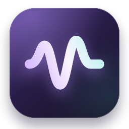

# Шёпот



Нативная голосовая клавиатура для macOS 14 и новее. Дважды нажмите и отпустите **Control**, надиктуйте мысль, нажмите **Control один раз** — запись сразу остановится, приложение оформит текст и вставит его в поле, выбранное перед записью. **Esc** отменяет запись. Во время AI-редактуры ещё один **Control** вставляет текст с базовой пунктуацией без ожидания AI; Escape в другом приложении редактуру не отменяет.

Проект написан на Swift / SwiftUI / AppKit. Для перефразирования используется установленный Codex CLI с моделью Luna.

**[Скачать Шёпот 0.2.7 для Mac с Apple Silicon (.dmg)](https://github.com/makamekm/shepot/releases/download/v0.2.7/Shepot-0.2.7-arm64.dmg)** · [Все релизы](https://github.com/makamekm/shepot/releases)

Откройте DMG и перетащите `Шёпот.app` на ярлык `Applications` («Программы»). Требуется macOS 14 или новее; текущая готовая сборка — arm64. Она подписана сертификатом Apple Development и не нотариализована для распространения. Для сборки из исходников см. раздел «Сборка и разработка».

## Первый запуск

1. Установите приложение из DMG либо соберите `dist/Шёпот.app` из исходников. Перенесите его в «Программы» **до** выдачи разрешений и откройте.
2. В окне Шёпота откройте «Настройки» → «Доступ к macOS».
3. Разрешите микрофон и распознавание речи. В «Универсальном доступе» включите именно **Шёпот**. Статус в приложении обновляется раз в секунду, в том числе пока открыты системные настройки. Если после перехода с версии 0.2.0 или старее переключатель включён, но доступ не определяется, удалите старую строку Шёпота из этого списка и добавьте текущую копию заново: кнопка «Показать приложение» покажет её в Finder. Это требуется один раз при переходе с временной подписи.
4. В «Перефразировании» включён **Codex · Luna** (`gpt-6-luna`). Нужен установленный Codex CLI с выполненным `codex login`; отдельный API-ключ не требуется, действуют лимиты вашего Codex. Кнопка «Проверить Codex» проверяет установку и авторизацию. По желанию можно выбрать отдельный обработчик OpenAI API со своим ключом.
5. Поставьте курсор в поле нужного приложения, быстро нажмите Control дважды и говорите. Одно нажатие Control завершает запись.

Приложение остаётся в строке меню после закрытия окна. Выход — через меню значка с волной или ⌘Q. В настройках есть автозапуск при входе в macOS.

## Как устроена работа

- **Диктовка:** Apple Speech, русский по умолчанию, ещё пять вариантов языков в настройках. Используется распознавание на устройстве, если модель доступна. При недоступности или обрыве локального распознавателя выполняется повторная попытка, в том числе через сервис Apple в интернете; переключатель «Только на устройстве» запрещает такой переход. Пауза, финал отдельной фразы и ошибка сервиса сами по себе не завершают запись. Непустая расшифровка сохраняется при пустых ответах. Доступность локальных моделей зависит от Mac, системы и языка.
- **Codex Luna:** распознанный текст и словарь передаются установленному CLI через stdin. Модель `gpt-6-luna`, усилие `low`; перефразирование, исправление ошибок, удаление слов-паразитов с сохранением смысла. Четыре стиля: «Аккуратно», «По-дружески», «По делу», «Списком». CLI запускается в одноразовом режиме `--ephemeral`, без пользовательской конфигурации и с отключёнными инструментами; аудио в Codex не отправляется. Нужен интернет. Редактура ограничена 12 секундами; при ошибке или тайм-ауте вводится сохранённый текст с базовой пунктуацией. Ещё одно нажатие Control во время редактуры пропускает AI. Для диктовок от 100 слов действует приблизительная защита от слишком короткого пересказа: число слов результата сравнивается с 60% количества различных слов исходника. Повторы распознавателя больше не раздувают минимально допустимый объём ответа; удаление дублей и слов-паразитов допускается. Это эвристика объёма, а не семантическая проверка всех фактов. Подозрительно короткий ответ заменяется сохранённым исходником.
- **«Списком»:** Luna выделяет самостоятельные мысли, задачи и требования даже в сплошном абзаце без пунктуации. Каждая мысль становится отдельным пунктом «•», а её пояснения и сроки остаются вместе с ней. Сохраняются исходный порядок и существенные детали, без краткого пересказа. При отключённом AI, ошибке, тайм-ауте или пропуске AI резервная обработка делит текст по предложениям, точкам с запятой, переносам и явным словам перечисления; смысловую группировку без AI она не выполняет. Готовые пункты AI нормализуются в тот же формат; длинный ответ одним блоком дополнительно разбивается резервной обработкой.
- **OpenAI API:** альтернативный обработчик через Responses API (`store: false`). Модель по умолчанию `gpt-5.6-terra`, отдельный API-ключ и оплата API. Используется только при явном выборе этого обработчика.
- **При выключенной редактуре:** Apple Speech и базовая обработка пробелов, заглавных букв, команд пунктуации/абзацев и словаря. Полноценного переформулирования в этом режиме нет.
- **Вставка:** во внешние приложения текст вводится Unicode-событиями клавиатуры после отпускания Control. Запись через Accessibility не используется: веб-редактор может принять такую команду, не изменив своё содержимое. Accessibility нужен для проверки фокуса и чтения результата. Успех показывается после сравнения фактического содержимого с ожидаемым текстом с учётом выделения. При сравнении нормализуются Unicode и пробельные различия; текст в самом поле не переписывается. Изменение высоты растущего поля чата не считается сменой фокуса. Внутри Шёпота используется `NSTextInputClient`. Поля паролей блокируются. Клавиша Return и сочетание ⌘V не отправляются.
- **Видимость текста:** панель размером 560 × 334 располагается выше Dock поверх окон. Расшифровка показана крупным контрастным текстом без ограничения в две строки, с автоматической прокруткой к последним словам. Во время записи и обработки текст также виден на главной. Длинная расшифровка остаётся целиком доступна при прокрутке; счётчик времени поддерживает часы.
- **Буфер обмена:** автоматическая диктовка его не читает и не меняет, в том числе при ошибках и отмене. Нет временной подмены и последующего восстановления. Только явно нажатая кнопка «Копировать» в истории/текстовом редакторе меняет буфер.
- **Закрытие панели:** после подтверждённой вставки панель сразу исчезает. Если все клавиши отправлены, но поле не даёт прочитать результат, панель также закрывается; это не помечается как подтверждённая вставка, а диагностическое сообщение остаётся в настройках. При реальной ошибке панель остаётся с текстом.
- **Если вставить не удалось:** текст остаётся в панели с причиной и кнопкой «Вставить в поле». Можно выбрать нужное поле и нажать эту кнопку. При отсутствии универсального доступа показывается явное требование разрешения; оно не заменяется копированием и не считается успешной вставкой.
- **История:** длинная запись сохраняется промежуточно при переходе между окнами распознавания, в одну и ту же запись без дубликатов. Черновик сохраняется до запуска AI и обновляется готовым текстом без создания дубликата. При явной отмене непустая расшифровка также сохраняется, если история включена. Последние 200 записей, поиск, оригинал, копирование, удаление и экспорт в TXT. Сохранение новых записей можно отключить; уже сохранённые удаляются отдельно.
- **Словарь:** пары «как звучит → как писать» с заменой целых слов и подсказками распознавателю. Повторное добавление обновляет существующую запись.
- **Текстовый редактор:** кнопка «Попробовать на тексте» на главной проверяет редактуру без микрофона и системных разрешений.
- **Проверка ввода:** в настройках есть кнопка «Проверить ввод». За 5 секунд выберите целевое поле: Шёпот введёт пример «Шёпот: проверка ввода 👋» тем же способом, что и диктовку. Микрофон и AI не запускаются, запись в историю не добавляется; Esc отменяет проверку.

## Ограничения первой версии

Общего ограничения длительности записи в приложении нет: запись продолжается до Control. Apple Speech работает окнами до 40 секунд; микрофон не выключается при переходе между ними. Последние 3 секунды передаются следующему окну как контекст, совпадающие слова на границе объединяются. Уже завершённые части текста сохраняются, а короткий ответ распознавателя не заменяет длинную расшифровку. Язык выбирается перед записью; автоматического определения смешанной речи пока нет. Для Codex нужен интернет, вход и доступный лимит; для обработчика API — ключ и баланс. При ошибке или превышении 12 секунд AI-редактуры используется базовый текст. Пока идут распознавание, редактура и ввод, панель показывает текущий этап и затраченное время. В настройках остаётся сводка длительности этапов. Настройки диктовки фиксируются на момент завершения записи.

Некоторые удалённые рабочие столы и нестандартные редакторы могут игнорировать Unicode-события. Если доступное для чтения поле осталось неизменным, показывается ошибка. Если поле изменилось, но точное совпадение не подтверждается, результат остаётся неподтверждённым без сообщения «текст не совпадает» и без повторной автоматической вставки. Если содержимое невозможно прочитать, но события отправлены и фокус не изменился, панель закрывается без дополнительного клика. Результат остаётся неподтверждённым: сообщение доступно в настройках, последний текст сохраняется в памяти, а диктовка — в истории, если она включена. При смене фокуса ввод останавливается. При остановке посреди длинного Unicode-ввода часть текста уже могла попасть в поле; перед повторной вставкой проверьте содержимое поля. Буфер обмена во всех этих случаях остаётся прежним.

## Сборка и разработка

Нужен Xcode либо Command Line Tools со Swift 5.9+ и существующий сертификат Apple Development или Developer ID в Связке ключей. Открыть `Package.swift` можно прямо в Xcode.

```sh
./scripts/build-app.sh      # release → dist/Шёпот.app
./scripts/make-dmg.sh       # dist/Шёпот.app → dist/Shepot-<версия>-<архитектура>.dmg
./scripts/run.sh            # собрать и открыть
swift test                 # детектор клавиш, текст, протокол AI
```

Можно дважды щёлкнуть `Запустить Шёпот.command`. Сборка рассчитана на архитектуру текущего Mac. `swift run` не используйте для микрофона: разрешения macOS должны быть привязаны к app bundle с Info.plist.

Начиная с 0.2.1 сборка подписывается существующим сертификатом Apple Development. Выбранный сертификат сохраняется локально в `.build/shepot-signing-identity`; следующие сборки используют его же. Можно явно указать `SHEPOT_SIGN_IDENTITY`. Ключи и сертификаты не копируются в проект. При отсутствии сертификата сборка прекращается, вместо временной подписи, которая меняла identity при каждом обновлении и ломала разрешения macOS.

Перед обновлением нужно закрыть Шёпот: скрипт отказывается перезаписывать запущенное приложение. Сборка и проверка подписи выполняются в отдельном временном каталоге, затем готовая `.app` заменяет предыдущую. Для распространения на другие компьютеры по-прежнему нужны Developer ID и нотариализация.

## Данные

- API-ключ: Связка ключей macOS, сервис `app.shepot.mac`, не исходники и не UserDefaults.
- История: `~/Library/Application Support/Shepot/history.json`, права файла `0600`, каталога `0700`. Файл не шифруется приложением; защита диска зависит от настроек Mac.
- Словарь, путь к Codex и настройки: UserDefaults домена `app.shepot.mac`.
- Авторизация Codex: используется самим установленным CLI. Шёпот не читает и не копирует токены.
- Временные stdout/stderr дочернего процесса Codex имеют права `0600` и удаляются после завершения; обычные сессии CLI не сохраняются (`--ephemeral`).
- Аудиофайлы не записываются. Для восстановления после обрыва Apple Speech в оперативной памяти удерживается не более 60 секунд аудио текущего сегмента. При штатном переходе между окнами остаются только 3 секунды контекста и звук, пришедший во время перехода; старый звук освобождается. Буфер очищается после завершения/отмены сеанса. В строгом локальном режиме повторные попытки также локальны.
- Системный журнал содержит коды ошибок, длительности этапов и факт наличия черновика; текст диктовок и аудио в диагностические сообщения не включаются.
- `store: false` отключает хранение состояния Responses; это не обещание нулевого хранения со стороны API. Действуют [правила обработки данных OpenAI](https://developers.openai.com/api/docs/guides/your-data).

## Проверки

`swift test` проверяет двойное нажатие для запуска, остановку одним Control, отсутствие повторного запуска, словарь, абзацы и пунктуацию. Проверки вставки покрывают ожидание отпускания Control, прямое изменение выделения в настоящем `NSTextView`, Unicode и emoji, неизменный `NSPasteboard.changeCount` на успешных и неуспешных путях. Отдельно проверены ложный успех Accessibility, проигнорированные события клавиатуры, отсутствие чтения результата и сравнение полного текста с учётом выделения. Проверки завершения диктовки подтверждают немедленное закрытие панели после ввода, отдельный неподтверждённый результат для непрозрачного поля и сохранение панели с текстом при отказе поля или смене фокуса. CLI проверяется отдельным тестовым исполняемым файлом: stdin, модель Luna, завершённый результат, тайм-аут и отмена дочернего процесса. Responses API проверяется подменённым транспортом. Дополнительно проверены сохранение непустых гипотез, продолжение после финала фразы, восстановление после обрыва, ограничение аудиобуфера, AI-тайм-аут/отмена/поздний ответ и базовый текст при ошибке AI. Для длинных разговоров добавлены проверки сброса гипотез, повторной выдачи всей фразы, повторяющихся фраз с временными метками, склейки контекста, сохранения аудио при переходе, единого черновика в истории, защиты от пересказа и отображения полного документа. В имитации 80-минутной записи проверены все 120 частей в исходном порядке, включая первую и последнюю. Это тест последовательности событий, не живая запись микрофона. Всего 88 тестов: 86 автоматических проверок без внешних запросов и две явно запускаемые проверки реального Codex. Регрессия с повторяющимися замечаниями к интерфейсу проверяет, что удаление дублей допускается и в режиме списка, и в деловом стиле, а короткий пересказ по-прежнему отклоняется. Вторая проверка: `SHEPOT_RUN_LIVE_CODEX=1 swift test --filter RepeatedDictationTests/testLiveLunaFormatsRepeatedFeedback`. Реальный запрос с повторяющейся диктовкой дал шесть пунктов за 7,5 секунды, и результат прошёл проверку объёма вместо возврата сырого текста. Проверены длинный абзац без переносов, сохранение всех 300 предложений в списке, числа и ссылки, пояснения внутри пунктов и полный список после тайм-аута AI. Для реального запроса: `SHEPOT_RUN_LIVE_CODEX=1 swift test --filter ListModeTests/testLiveLunaSplitsUnpunctuatedDictationByMeaning`. Сплошная тестовая диктовка без пунктуации превратилась через Luna в шесть смысловых пунктов за 6,4 секунды с сохранением контрольных сроков, чисел и деталей.

Панель проверена отдельной отрисовкой на короткой и длинной расшифровке, при восстановлении распознавания и при ожидании AI (`docs/previews/recording-recovery.png`, `docs/previews/processing-editing.png`): `docs/previews/recording-short.png`, `docs/previews/recording-long.png`, `docs/previews/recording-hour.png`. Это примеры с тестовым текстом без микрофона. Для повторной отрисовки: `swift build`, затем `.build/debug/Shepot --render-hud-preview .build/hud-previews`.

Сборка и подпись проверены на macOS 15.6.1 / Apple Silicon / Swift 6.2. Перефразирование через установленный Codex Luna проверено реальным запросом; контрольный короткий запрос занял 7,8 секунды. Восстановление Apple Speech проверено на состояниях и буферах без микрофона; воспроизведение реального обрыва системного сервиса во время живой диктовки автоматически не проводилось. Универсальный доступ выдан и сохраняется после пересборки. Прямое изменение текста проверено на `NSTextView`, клавиатурный ввод — в локальном поле Chrome с настоящими событиями `input`; пользователь сообщил, что ввод в ChatGPT также заработал. Автоматизированная проверка самого окна ChatGPT не выполнялась. OpenAI API с реальным ключом не проверялся.

Для ручной проверки веб-редакторов откройте `Tests/Fixtures/input-check.html` в браузере. Там есть обычное поле и `contenteditable`, которые сохраняют состояние только по событию `input` и каждые 250 мс восстанавливают его. Счётчик показывает фактические события и сохранённый текст. Запустите «Проверить ввод», переключитесь в видимое окно браузера и поставьте курсор в одно из полей. На время проверки оставьте фокус в этом поле.

## Структура

- `Sources/WhisperCore` — детектор двойного Control, стили, словарь и базовое оформление.
- `Sources/Shepot` — интерфейс, Apple Speech, AppKit-панель, вставка, история, Связка ключей, OpenAI.
- `Tests` — автоматические проверки без микрофона и внешних запросов.
- `Resources` — Info.plist и entitlements.
- `scripts` — сборка `.app` и отрисовка иконки.
- `docs/INTERFACE.md` — решения по интерфейсу и поведению.

Идея конвейера «клавиша → микрофон → распознавание → вставка» изучена по [wispr-flow-rea-teardown](https://github.com/az9713/wispr-flow-rea-teardown). Это самостоятельная реализация; исходники прототипа не скопированы. Технические источники: [Apple Speech](https://developer.apple.com/documentation/speech), [Responses API](https://developers.openai.com/api/docs/guides/migrate-to-responses).
